# New World as one system: the graph, its loops, and Scrip against it

Written 2026-11-12, round 3. The graph itself is in `nw-system.dot` in this folder
(`dot -Tsvg nw-system.dot -o nw-system.svg`, then open it and zoom; it is large).
This page explains it and answers six questions: the loops, the spine at each stage,
where loot, crafting and trade meet, which parts players find compelling, how Scrip
compares, and the smallest graph that keeps the spine.

Why this exists: three slices were built (a calm gathering zone, a lull between waves,
kills that drop toward one tracked recipe) and each was boring. The owner's verdict was
"a bespoke solution to a single slice of the problem instead of focusing on a bigger
picture". The owner later added a second diagnosis: **"weapons and tools are given to
you by default and not crafted."** That diagnosis runs through sections 3, 5 and 6.

## How to read the tags

- **[S]**: confirmed by a source read in this session. Most refining, tool, weapon,
  trophy and fee numbers now come from nwdb.info's recipe data (current, Aeternum era).
  Housing, town projects, settlements, war, travel and coin come from the fandom wiki API.
  The rest comes from search-result summaries.
- **[M]**: from memory, or approximate.
- **[D]**: derived by arithmetic from [S] numbers.
- Numbers drift a lot between patches (2021 launch, 2022 Brimstone Sands, 2023 Rise of
  the Angry Earth, 2024 Aeternum). The shape matters more than the patch.

**Corrections to `../research-new-world.md`** (not edited here; noted for whoever owns it):
- One orichalcum ingot contains 48 iron ore, not 12. It needs 2 starmetal ingots, those
  need 4 steel, and the steel needs 12 iron *ingots*. In full: 8 orichalcum ore, 12
  starmetal ore, 48 iron ore, 14 charcoal (28 wood) and 7 flux [D].
- Station tiers no longer gate refining or crafting. In current data every refine and
  every craft lists a tier 2 station [S, nwdb]; at launch orichalcum needed tier 5 [S].
- At launch, house tax was 10% of the house's base price each week, with a floor of
  250 / 500 / 750 / 1,000 by tier [S]. Patch 1.3 later cut it to about 5% [S].
- Asmodeum has a cooldown of 10 per 24 hours [S]. Tier 3 leather and cloth take no new
  raw material: 4 coarse leather + 1 tannin makes rugged, and 4 linen + 1 weave makes sateen [S].

---

## The graph in brief

Thirteen clusters, numbered in the dot file roughly in reading order, left to right:

1. **Gathering.** Five skills, a luck roll on every node, and a tier gate on every node.
2. **Refining.** Each tier eats the tier below. The cluster ends in the legendary refined goods.
3. **Crafting.** Gear, tools, food, furniture, trophies and storage. The craft screen
   shows the gear score (GS) range before you commit.
4. **Drop-only keys.** Mods, schematics and patterns, chosen-outcome items, materia,
   raid keys, trophy keys and sealed faction armour. Crafting cannot make these, and loot
   cannot skip them.
5. **The loadout.** Weapons, armour, jewellery and tools. Every edge into it is coloured
   by where the gear came from: crafted, dropped, or bought or earned. A table shows the
   crafted share at each stage. Gear score and the content gates hang off it.
6. **Character.** Quests, level, attributes, mastery and the level bands.
7. **PvE content.** Open world, portals, elite zones, expeditions, mutations, the raid, chests.
8. **PvP and faction.** Faction missions, the flag, Outpost Rush, wars, arenas, the reward
   track, ranks and the faction shop.
9. **Town and territory.** The town board, town projects, stations, settlement tier,
   standing and its perks, the trading post and the storage shed.
10. **Housing.** Houses, trophy racks and recall.
11. **Coin, azoth and travel.**
12. **Season pass.**
13. **Sinks.**

### Faucets (green), sinks (red), gates (orange)

| Faucets: value from nothing | Sinks: value destroyed | Gates: a number to reach |
|---|---|---|
| Resource nodes, shared, respawning ~8-40 min [S] | Crafting and refining fee: 1 / 4 / 7 / 13 coin per refine at T2-T5; 449 per T5 weapon or tool; 3,000 for a prismatic scarab; 20,000 for one raid armour piece [S] | Gather at skill X, compass tracking at X+25 (iron 0, starmetal 100, orichalcum 175) [S] |
| Mob drops: coin, hides, gear [S]. PvP made ~1/5 of all coin in 2023 [S] | Repair: coin + repair parts; death costs durability [S] | Recipe needs skill X (e.g. Engineering 150 for orichalcum tools) [S]. Station tier: was T5, now T2 [S] |
| Quests, the town board and missions: coin, XP, azoth, standing [S] | Trading tax: 2.5%, then 5% [S] | Zone level bands: 1-17, 26-35, 41-50, 51-60, 60-65 [S] |
| Chests: provisions (~60 min), supply, ancient, elite (1 a day each) [S] | Listing fee, paid up front, kept if unsold [S] | GS for content: ~600 elite zones, 630 Glacial Tarn, mutation floors [S] |
| Expedition, mutation and raid caches [S] | House tax every 7 days [S]; town upkeep every 7 days [S] | Lockouts: elite chests daily, expedition rewards daily, raid weekly [S] |
| Salvage: a little coin + repair parts [S] | Travel: 50 azoth base + distance + weight [S] | Houses at level 15 / 35 / 55 and standing 10 / 15 / 20 / 30 [S] |
| Season pass rewards: coin 500-3,000 a step, shards, boosts [S] | Faction vendor: top item 7,000 tokens + 1,500 coin [S] | Faction rank: 3k / 11k / 26k / 49k reputation [S] |
| Real money into Marks of Fortune | Respec (coin), mastery respec (azoth); declaring a war, 7,500-15,500 coin [S] | Season premium track: 20,000 Marks of Fortune [S] |
| | Every input consumed by a craft, refine or hand-in | |

### The rates that set the shape

| Flow | Rate | Tag |
|---|---|---|
| Iron ingot | 4 iron ore | [S] |
| Steel | 3 iron ingot + 2 charcoal + 1 flux | [S] |
| Starmetal ingot | 6 starmetal ore + 2 steel + 2 charcoal + 1 flux | [S] |
| Orichalcum ingot | 8 orichalcum ore + 2 starmetal ingot + 2 charcoal + 1 flux | [S] |
| Asmodeum | 5 orichalcum ingot + 2 cinnabar (rare) + flux + 2 charcoal; 10 a day | [S] |
| Prismatic ingot | 1 asmodeum + 10 mythril ingot (each 12 mythril ore + 2 orichalcum ingot) + 4 flux + 4 charcoal | [S] |
| Wood, leather, cloth, stone | same shape: 4 raw to T2, then 2 of the tier below + 6 / 8 new raw + 1 reagent | [S] |
| Charcoal | 2 wood | [S] |
| Refining XP per ingot | 44 / 276 / 2,442 / 12,012 at T2-T5 | [S] |
| Orichalcum greatsword | 14 T5 metal + 7 refined wood + 2 leather; base GS 500. That is ~112 orichalcum, 168 starmetal and 672 iron ore | [S] / [D] |
| Orichalcum mining pick | 15 T5 metal + 3 refined wood + 2 leather, Engineering 150 | [S] |
| Tool speed | x1, x1.25, x2.5, x4, x6.25 by tier; perks +10-19% yield, +2-9% luck | [S] |
| GS range modifiers | skill up to +25; rare materials up to ~+45 to min; crafting food +15; crafter set +15; trophies +15; town buff +5; all stacked: 590-600 at the 600 cap | [S] |
| Basic trophy | 25 wyrdwood planks + 20 starmetal + stain + 1 drop-only key + the minor trophy, giving +1,000 luck in one skill | [S] |
| Raid armour piece (725 GS) | 120 prismatic ingot + 80 prismatic leather + 60 prismatic cloth + 3 raid keys + a prismatic scarab | [S] |
| Expedition replica | 1,000 mutator materia + 5,000 expedition materia, at the kiln, gives the named item you choose | [S] |
| Luck roll | 0-100,000 + luck; 1% luck = 1,000 points; void ore 0.0045%, or 0.105% at +5k luck | [S] |
| House | 5k / 10k / 15k / 20k coin; recall every 4 h to 2 h; 1-4 storage chests; 5 trophies | [S] |
| Levelling | 1-65 in ~20-30 h (2024); 60-200 h at launch | [S] |
| Season XP | 8,300 for a full activity card; an early pass level is 2,500 | [S] |

---

## 1. The loops

Every reinforcing loop in the graph. The **period** is how long one trip round the loop
takes for a typical engaged player.

| # | Loop | Period of one trip | Brake on it |
|---|---|---|---|
| **R1** | **Gear ladder.** Higher GS opens harder content (elite zones, expeditions, mutations, raid). That content drops higher-GS gear and drop-only keys, which become higher GS. | Daily for a small step (elite chests, gypsum, expedition rewards per day [S]); weekly for the top (mutation rotation, raid, prismatic scarab) | Lockouts; the expertise watermark (2021-23); the GS cap |
| **R2** | **Crafter's ladder.** A craft earns skill XP. Skill opens the next recipe tier and up to +25 GS, so the next craft is worth more and earns more XP. | A level takes minutes early, hours late. A tier (50 levels) takes hours to days [M]. XP per craft grows ~5-10x a tier [S] | Input pyramid; low-tier XP cut in 1.1.1 [S] |
| **R3** | **Gatherer's ladder.** Gathering earns skill XP. Skill opens the next node tier, and 25 levels later the compass starts showing it. Higher nodes give more XP and value. | A level takes minutes. A new tier takes ~50-75 levels, several hours [M] | Respawn timers, shared nodes |
| **R4** | **Tool loop.** Gather and refine, then Engineering makes a better tool (x1.25 to x6.25 speed, yield and luck perks), so the next trip gathers more an hour. | One tool tier per skill tier; hours to days [M] | Character-level gate on tools [S] |
| **R5** | **Luck loop.** Chests drop trophy keys. Trophies give +500 / 1,000 / 1,500 luck, and luck food helps too. That means more rare siblings, which sell or go into higher crafts, which pay for houses 2 and 3 and more trophies. | Weeks | 5 trophies a house, 3 houses; tax |
| **R6** | **Market loop.** Produce, sell on the trading post (less 5% tax and the listing fee), get coin, buy the inputs you lack, produce something worth more. | Hours for a sale; about a day round trip [M] | Deflation when everyone gathers [S]; taxes |
| **R7** | **Levelling loop.** Quests and kills give XP. A level opens the next zone band, with better quests, nodes and drops, so XP comes faster. | ~20-30 min a level in 2024 [D]; 1-3 h at launch [D] | Level cap 60, then 65 |
| **R8** | **Territory loop.** Anything done in a territory raises standing. Each level picks a perk (+gather speed, +XP, -tax, +storage, +tokens), which makes the next activity there cheaper or faster. | Minutes per level early; the 300 cap takes months [M] | One territory at a time |
| **R9** | **Town loop (shared).** Hand-ins raise station tier, settlement tier and the town buff, so crafters do better there and stay, and hand in more. | Days to weeks [M] | Weekly upkeep, invasions; since flattened (T2 is enough) [S] |
| **R10** | **Faction loop.** Missions give tokens and reputation. Rank opens shop stock (sealed armour, converters for reagents), which makes missions easier. | Rank 5 at 49k reputation is ~110-160 PvP missions, ~15-30 h [D] | Token caps per rank [M] |
| **R11** | **PvP loop.** Outpost Rush, wars and arenas give salt and PvP XP. The track gives a 690 GS named item every 10 levels, and better gear wins more. | A checkpoint at 10k PvP XP is ~4 wins at 2,500 each, a few hours [D] | Level 60 to enter; arena rewards cut [S] |
| **R12** | **House loop.** Coin buys a house. The house gives trophies, storage and free recall, which make you more efficient and earn more coin. | Weeks | House tax every 7 days [S] |
| **R13** | **Season loop.** Every activity earns season XP. Pass levels give coin, shards and XP boosts, which make everything faster. | A card is ~3 early levels; 100 levels a season [S]/[M] | The season ends |
| **R14** | **Discovery loop.** Chests and elites drop a rare schematic or pattern. The recipe is known for good, and the unique item sells, paying for other schematics. | Weeks to months (some schematics are famously rare) [S] | Drop rates |
| **R15** | **Key-to-craft loop (late game).** Content drops materia, raid keys and patterns. Crafting turns them into the named item you choose, with higher GS, which opens harder content. This is R1 routed through crafting. | Weekly [S] | Cooldowns, huge material cost |

Balancing loops in the graph: **B1** everyone gathers, so raw prices slide toward 0.01
and gathering for sale stops paying [S]. **B2** sinks grow with activity (fees, tax,
repair). **B3** lockouts throttle R1. **B4** the expertise watermark scaled down items
above it, which throttled R1 and made crafting feel worthless [S]. **B5** the pyramid:
each tier costs 6-12 new raws plus 2 of the tier below [S], so the cost of one top item
grows about 4-5x a tier [D].

## 2. The spine at each stage

| Stage | Spine loop | What the player is chasing | Running alongside |
|---|---|---|---|
| **Levels 1-25** | **R7 levelling**, carried by quests | The next level and the next zone; the first steel tools (~level 17 [S]); the first house at 15; the first expedition at 25 | R3 and R4 tick on every node; R2 starts with tools and food |
| **Levels 25-60** | **R7**, with **R3/R2** thickening | Level cap; Mining or Smelting 100 (starmetal), then 150-175 (orichalcum); a T5 tool; the 2nd and 3rd house; an expedition every ~10 levels as a gear checkpoint | R8 standing and perks; R6 starts paying (sell T3-T4 goods) |
| **Early endgame (60-65, GS 600-700)** | **R1 gear ladder**, as daily routines | GS to the cap; perks; major trophies; trade skills to 200/250 | R6 funds it; R2 comes back as 590-600 crafting with mods; R10 and R11 as other routes to gear |
| **Late endgame (GS 700-725)** | **R1 + R15**, weekly | 725 GS, perfect perk sets, artifacts, cosmetics | R6 is the spine for crafters (prismatic goods); R5; R13 season pass |

The spine moves from **your level** (R7) to **your gear score** (R1). The thread that runs
through every stage is the trade-skill bars (R2 and R3). With ~50 parallel bars, one is
always close to a ding.

## 3. The links: loot, crafting, trade, and where the loadout comes from

### Where the three touch

- **The trading post** is the one node that all three feed and draw from. Raws,
  refined goods, crafted gear, tools, furniture, keys and schematics all sell there, and
  coin buys whatever you lack.
- **Drop-only keys** feed crafting: mods, schematics and patterns, materia, raid keys,
  trophy keys, sealed armour, and reagents at launch. Loot feeds the chain; it does not
  bypass it.
- **Crafted gear** feeds content. Crafted weapons, armour and food raise GS and survival.
  Crafted tools raise gathering speed. Crafted trophies raise luck and the craft floor.
- **Refined goods** feed the town: board missions and project hand-ins [S].

### What each gives that the others cannot

| | Gives | Why it stays relevant |
|---|---|---|
| **Loot** | Surprise, and the keys: anything crafting cannot make (mods, patterns, materia, raid keys, trophy keys), plus the odd ready-made named item | Without it, crafting has no rare inputs and no reason to fight |
| **Crafting** | Control and the floor. It turns quantity into quality (the pyramid), shows the range before you commit, lets you choose perks (mods, scarabs), and is the only source of tools, trophies, furniture and food | Without it, loot is a lottery, and gathering has no buyer |
| **Trade** | Conversion and specialisation. Any surplus becomes any need; there are prices; a gatherer can supply a crafter | Without it, every player must do every loop; with it, a player can live in one loop |

### Where the loadout comes from (the owner's diagnosis)

Cluster 5 of the graph draws every source of equipped gear:

- **Crafted.** Standard weapons, armour and jewellery. **All tools**: every tool recipe
  is Engineering [S], and tools otherwise come only from the trading post (player-crafted)
  or, rarely, a supply chest [S]. Named items crafted from patterns. Expedition replicas
  bought with materia at the kiln. Raid armour made from raid keys. Faction armour opened
  from a sealed drop with 50 azoth [S].
- **Dropped.** Quest rewards (the main source while levelling [M]), mobs, elite chests,
  expedition bosses (named, fixed perks), mutations (up to 700 GS), the raid (725 GS) [S].
- **Bought or earned.** Trading post, faction shop, the PvP track (a 690 GS named item
  every 10 levels), season pass artifacts [S].

**Share of the equipped loadout that was crafted (by anyone)** [M] / [D]:

| Stage | Weapons, armour, jewellery | Tools |
|---|---|---|
| 1-25 | Low, ~10-30%: quest rewards and drops dominate | Nearly all crafted (yours or off the post) |
| 25-60 | ~20-40%: drops and quests, plus cheap crafted gear off the post to fill gaps | Nearly all crafted |
| Early endgame, 600 cap | ~40-70%: crafted 590-600 with chosen mods is best-in-slot for most slots; named drops for unique perks | All crafted, with perks |
| Late endgame, 700-725 | About half or more, but drop-gated: replicas, raid gear, patterns, prismatic "artisan" items | All crafted |

What the recipe data shows [S/D]: of ~8,100 recipes on nwdb, ~4,400 sit in categories
where a drop-only key turns into an item. Those are expedition replicas (~870), named
replicas (~320), patterns (339), named item crafting (~1,160), faction gear (~1,430),
PvP replicas (169), raid equipment (72) and artifacts (78). Over five years New World
stopped choosing between "drops" and "crafting". Its answer became: **the drop is the
key, the craft is the item.** The 2021 expertise row, when crafted gear was scaled down,
was the low point of the other approach [S].

Two facts matter most for Scrip. Tools in New World are always made, and the tool you
hold is the felt result of the chain (x6.25 speed). And at endgame, the best weapons are
made from keys the fight dropped.

## 4. What players find compelling

**Nodes and edges that carry the experience** (the moments players name):

- **Gather to rare sibling** (the luck roll on a mundane node) and the strike itself:
  sound, break, item fountain. "Makes me want to mine rocks forever" [S].
- **Skill bar to gate to next tier.** The ding, and the locked node you have been looking
  at switching on [S].
- **Craft to GS range to roll.** The preparation stack made legible as "590-600" [S].
- **Crafted gear to content.** "There's no better feeling than wearing gear you've
  painstakingly assembled yourself" [S]. The self-made weapon is the payoff of the
  whole chain.
- **Chest, boss or elite to a key or schematic drop.** The surprise.
- **Sale to coin.** The first big sale; specialising.
- **House trophies.** A home base that gets better for you.
- **Expeditions with friends**, as the gear checkpoint.

**Support** (needed, rarely remembered): refining in bulk, storage chests, town projects,
standing perks, faction missions, the season pass, azoth and travel, the town board.

**Chores** (what players complained about): repair, house tax, town upkeep, travel cost and
encumbrance, shed transfers, daily lockouts and gypsum dailies, the expertise grind,
low-tier craft spam for XP, managing listings, and chest-run zergs (divisive) [S]/[M].

The compelling edges cluster on two paths:
**gather → (rare) → refine → craft (range) → wear → harder content → key → craft**, and
**skill bar → gate**. The chores cluster on the sinks and on travel.

## 5. Scrip against the graph

### Which nodes exist

| New World node | Scrip equivalent | Where | Status |
|---|---|---|---|
| Open-world combat, expeditions | The run: 12 waves (~13 min to win), auto-firing weapons, elites, a boss; daily clearing of 8 waves | `src/sim/run.ts`, `server/runs.ts` | **live** |
| Content tiers by GS | Hazard 0-5 per character. A win at n opens n+1; a kit item brings at most 13 / 26 / 40 / 58 / 80 points | `src/shared/kit.ts`, `server/runs.ts` | **live** |
| Character level | In-run level-ups that pay upgrade picks; no lasting level | `src/sim/bench.ts` | **live, run-scoped** |
| Gathering nodes | Tree, seam and carcass in the run, giving timber, ore and hide. Yield = base + Harvest/10 + (station tier - 1) | `src/sim/world.ts` `nodeYield` | **live, 1 tier** |
| Gathering skills | 4 skill bars, tier 2 nodes at skill 5 (outing); skill XP during lulls | `src/sim/outing.ts`, `src/client/outing/store.ts`, `src/sim/world.ts` `LULL` | **prototype, device only** |
| Materials by tier | 3 raws, one tier. The outing has 8 materials in 2 tiers; the loot prototype has silver and thick hide | `src/shared/vocab.ts` `RAWS`, `src/client/loot/content.ts` | **live: 1 tier; prototype: 2** |
| Refining | Steel = 4 ore + 1 timber; leather = 4 hide | `src/client/loot/content.ts` `REFINES` | **prototype** |
| Schematics | 3, dropped by elites and the boss (35-70%) | `src/sim/core.ts` `LOOT_TABLE`, `src/client/town/loot.ts` | **prototype** |
| Crafting gear | **Fusion**: two items become a new one with a model-chosen effect list, budget (A+B) x 1.4. In-run at the bench; in town for marks + 3x raws. It never makes weapons or tools | `server/fusion.ts`, `src/shared/item.ts`, `src/shared/rules.ts` `townFuseCost` | **live** |
| Weapons and tools | **Given or bought.** The start weapon is free (`start` in `src/sim/data/characters.ts`, used by `createRun`). Every other weapon and the 3 tools (hatchet, pick, knife) are bought for scrip at the between-wave bench | `src/sim/data/weapons.ts` (`price`, `raws`), `src/sim/bench.ts` | **live: never crafted** |
| Crafted weapons | Steel hatchet (3 steel + 4 timber) and silver sling (3 steel + 4 silver), carried in beside your own weapon | `src/client/loot/content.ts` | **prototype only** |
| Loadout / kit | 2 kit slots, 3 charges, packed down to the hazard's point cap | `src/shared/protocol.ts`, `src/shared/kit.ts` | **live** |
| Rare loot | Relics: 1 in 1,500 wins, numbered, rule-breaking, tradeable with history gates | `server/relics.ts`, `server/config.ts` | **live** |
| Discovery | First finder of a fused pair names it; codex; titles | `server/fusion.ts`, `server/almanac.ts`, `src/shared/almanac.ts` | **live** |
| Coin | Marks = floor(scrip held, capped / 20) + 3 a wave, x (1 + 0.1 x hazard) | `server/runs.ts`, `server/config.ts` | **live** |
| Trading post | Item listings (price cap 20 marks a point), raw lots, buy orders; 2% listing fee, 5% sale tax with half to the town project; player trade after 10 runs | `server/market.ts`, `src/shared/rules.ts` | **live** |
| NPC price floor | The Factor buys raws at 0.5x the reference and sells at 2x; 150 a day; drift with saturation | `server/market.ts`, `server/config.ts` `FACTOR` | **live (New World had none)** |
| Town projects, station tiers | Sawmill, smelter, tannery, assay T1-5 from shared hand-ins (unit x (toTier - 1) x players). Then "works" with a week-long perk | `server/town.ts`, `server/config.ts` | **live** |
| Territory standing | `standing` = total given; shown on a board, unlocks nothing | `server/town.ts` | **live, dead end** |
| Storage | Stash of 24 items, +8 a shelf to 96, for 150-3,500 marks + raws | `src/shared/rules.ts` `STASH`, `server/workshop.ts` | **live** |
| Repair | 2 marks a point (min 15) + raws; at most twice per item | `src/shared/rules.ts` `REPAIR`, `server/workshop.ts` | **live** |
| Housing, trophies, furniture | none | | **missing** |
| Trade-skill levels | none (fusion has no skill) | | **missing** |
| Consumables, preparation | none outside the run | | **missing** |
| Faction, PvP, season pass, azoth, travel, taxes | none (rightly left out by `../plan.md`) | | **out on purpose** |

### Loops that are closed

- **In-run Brotato loop.** Kills give scrip, scrip buys weapons, upgrades and fusions at
  the bench, and more power gives more kills. ~13 min (`src/sim/bench.ts`). This is where
  "meeting the curve" lives today.
- **Kit loop.** Raws and marks go into town fusion, the item goes into the kit, the kit
  makes a better run, and the run pays marks and raws. One run a trip. It is deliberately
  braked by the hazard point cap, 3 charges and 2 repairs.
- **Station loop (shared).** Raws go into a project, the station tier rises, and every
  node gives +1 raw a tier. Slow, and weak as a payoff (`server/town.ts`, `src/sim/world.ts`).
- **Market loop.** Sell to the Factor or post a listing, get marks, buy raws or items.
  Closed, with a floor and a ceiling.
- **Discovery loop.** An untried pair gives a new named item, first-finder credit, a codex
  entry and titles. This is the part the owner said "glimpses of discovery were fun".
- **Hazard ladder.** A stronger kit opens a higher hazard, which pays +10% marks a level.
  Closed, but it pays in coin, not in kind.
- **Loot prototype.** Kills drop raws, rares and schematics; you refine, make and pack,
  and the next run is stronger. Closed on the device for 3 recipes, then it ends.
  Played, and still boring (`../round2/decisions.md`): it was one slice, and the crafted
  weapons only rode along beside the free one.

### Loops that are open (the node exists, the return edge does not)

- **R1, the gear ladder.** A higher hazard drops nothing rarer: relic odds do not move
  with hazard (`src/shared/rules.ts` `HAZARD_MARKS` comment), and there is only one tier
  of material. Gear opens content, but content does not feed gear.
- **R3, the gatherer's ladder.** Skill XP is banked, but almost nothing reads it.
  `src/client/outing/store.ts` says "nothing in the town reads it yet". The lull's skill
  bars open no tier in the live run.
- **R8, standing.** Giving raises a number on a board (`server/town.ts`). It gives no perk.
- **R14, discovery.** Relics are only ever a kit item; nothing is crafted from them, and
  the live game has no schematic drop.
- **R6 on the spend side.** Marks buy little that makes you stronger: shelves, repairs,
  fusion fees.

### Loops that are missing entirely

- **The crafted loadout (the owner's diagnosis).** The chain gather → refine → craft gear →
  use it to reach harder content and rarer materials does not exist. Weapons and tools
  are given (the free start weapon) or bought for in-run scrip, which is gone at the end
  of the run. Town fusion makes kit items, never weapons or tools. In New World this is
  the most-travelled edge in the graph. In Scrip it is absent.
- **R2, trade-skill levels** and their gates and craft floor.
- **R4, tools as a crafted upgrade.** Hatchet, pick and knife exist as weapons with a
  "works this node at double rate" flag (`src/sim/data/weapons.ts`), but they are bought
  at the bench.
- **The tier chain.** A refine that eats the tier below, with reagents.
- **R5, the luck loop and housing.** There is no trophy rack, and no lasting luck.
- **The craft range screen** with preparation that moves it.
- **R15, drop key to chosen craft.**

**In one line:** Scrip has New World's town (stations, market, sinks, discovery) and
Brotato's run. The edge that joins them is the crafted weapon or tool you carry into the
fight, and it is missing. So the town makes kit items that the hazard cap packs down,
the run makes scrip that it spends on itself, and neither feeds the other's spine.

## 6. A minimal subgraph, and how to make the loadout the output of the chain

### Rules for a small game: "the town forges the loadout, the run bends it"

This keeps the owner's two halves: "in the town it gets stronger over years, outside each
run could become wilder".

1. **Every weapon and tool you start a run with was crafted in town.** It comes from a
   recipe (known by default at T1, a schematic above that) and refined materials. The free
   start weapon becomes the plain T1 recipe, made once in the first minute, the way
   New World's first tools are made at camp [M]. The material tier sets the weapon's tier.
2. **The bench stops selling weapons and tools.** It sells what Brotato sells: upgrade
   picks, items and augments, plus in-run tier-ups. Those are **bounded by the crafted
   item**. A crafted weapon has a tier T and S augment sockets, both from its craft roll
   (the range screen). In a run it can rise to T+1 at most and hold S augments. Crafting
   sets how wild a run *can* get; the run decides *how*. Meeting the curve stays inside
   the run, but home decides which curve you can meet. This replaces the packing cap in
   `src/shared/kit.ts` with something you can see on the item.
3. **Hazard pays in kind.** A stronger loadout opens a higher hazard, and each hazard
   drops the next material tier and its schematics. A rare from tier H+1 is visible but
   locked. This closes R1.
4. **Loot drops keys, not finished weapons.** Schematics, rare siblings, and a "materia"
   that buys the named item you choose. Relics stay the rule-breakers. That is New World's
   late-game answer (section 3), and it keeps crafting relevant without making loot dull.
5. **Gear wears.** The existing 3 charges and 2 repairs carry over to weapons and tools.
   Demand never stops, and low tiers stay wanted as inputs and for repair (New World's
   B5 without the grind).
6. **Tools are crafted weapons with a family bonus.** The hatchet, pick and knife already
   exist in `src/sim/data/weapons.ts`. Crafted, they raise what kills and nodes of their
   family drop, or its rare roll. That is R4 in a game where gathering happens in the fight.
7. **The market trades materials, keys and crafted weapons and tools.** Keep the Factor's
   floor and the points-based price cap; crafted gear wears, so it keeps selling.
8. **The town still grows over years.** Station tier caps the highest craft tier, known
   schematics accumulate, and trophies raise the craft floor and luck.

### The smallest graph that keeps New World's spine

It keeps R1 (gear ladder), R2 (crafter's ladder), R4 (tools), R5 (luck via trophies),
R6 (market), R9 (town stations) and R14/R15 (keys to crafts), plus Brotato's in-run loop
bounded by the loadout. It drops the level loop R7 (hazard plays that part), standing,
faction, PvP, the season pass, azoth and travel, and taxes beyond one sale tax and a craft fee.

```dot
digraph ScripSkeleton {
  graph [rankdir=LR, compound=true, fontname="Helvetica", fontsize=12, labelloc=t, labeljust=l,
         label="Minimal skeleton: New World's spine loops for a small game. Violet = the crafted loadout edge Scrip lacks.\l"];
  node  [fontname="Helvetica", fontsize=10, style=filled, fillcolor="#f5f5f4", color="#57534e"];
  edge  [fontname="Helvetica", fontsize=8, color="#475569", arrowsize=0.6];

  subgraph cluster_run {
    label="Run (Brotato's loop, bounded by the loadout)"; style=rounded; color="#f59e0b";
    RUN    [label="Run at hazard H\n12 waves, elites, boss", shape=box, style="rounded,filled", fillcolor="#dbeafe", penwidth=2];
    DROPS  [label="Kills, elites, chests (FAUCET)\nmaterials of tier H, keys", shape=box, fillcolor="#bbf7d0", color="#15803d"];
    BUILD  [label="In-run build\nlevel-up picks, bench augments,\ntier-ups (up to T+1, S sockets)", shape=octagon, fillcolor="#ccfbf1"];
    SCRIP  [label="Scrip (run only)", shape=ellipse, peripheries=2, fillcolor="#fde68a"];
  }
  subgraph cluster_chain {
    label="Town chain"; style=rounded; color="#60a5fa";
    MATS   [label="Materials T1..T5\n+ rare siblings"];
    KEYS   [label="Keys: schematics,\nrare drops, materia", fillcolor="#fef9c3"];
    REFINE [label="Refine\n2 of tier N-1 + raws + reagent", shape=box, style="rounded,filled", fillcolor="#dbeafe"];
    CRAFT  [label="Craft: range shown\ntier T, sockets S, perk", shape=box, style="rounded,filled", fillcolor="#dbeafe", penwidth=2];
    SKILL  [label="Trade-skill level", shape=octagon, fillcolor="#ccfbf1"];
    GREC   [label="GATE: recipe tier\n(skill + station)", shape=hexagon, fillcolor="#fed7aa", color="#c2410c"];
    STAT   [label="Stations T1-T5\n(hand-ins)", shape=box3d, fillcolor="#e7e5e4"];
    TROPHY [label="House trophies\n+luck, +craft floor", shape=note, fillcolor="#ede9fe"];
  }
  subgraph cluster_loadout {
    label="Loadout (crafted)"; style="rounded,bold"; color="#7c3aed";
    LOAD   [label="Weapons + tools + kit\ncrafted, wear 3 charges", shape=note, fillcolor="#ddd6fe", penwidth=2];
    POWER  [label="Loadout power\n(tier, sockets, points)", shape=octagon, fillcolor="#ccfbf1"];
    GHAZ   [label="GATE: hazard H opens\nat loadout power P(H)", shape=hexagon, fillcolor="#fed7aa", color="#c2410c"];
  }
  subgraph cluster_econ {
    label="Economy"; style=rounded; color="#b45309";
    COIN   [label="Marks", shape=ellipse, peripheries=2, fillcolor="#fde68a"];
    MARKET [label="Market + Factor floor\nmaterials, keys, crafted gear", shape=box, style="rounded,filled", fillcolor="#dbeafe"];
    SINK   [label="SINKS: craft fee, sale tax,\nrepair, inputs consumed", shape=box, fillcolor="#fecaca", color="#b91c1c"];
  }

  RUN -> DROPS [color="#15803d"];
  DROPS -> MATS [color="#15803d", label="tier H; rare of H+1\nvisible, locked"];
  DROPS -> KEYS [color="#15803d"];
  DROPS -> SCRIP [color="#15803d"];
  SCRIP -> BUILD [color="#b45309", label="bench"];
  BUILD -> RUN [color="#1d4ed8", style=dotted, label="meet the curve"];
  MATS -> REFINE -> CRAFT;
  KEYS -> CRAFT [color="#a16207", label="schematic or materia\n= what to make"];
  CRAFT -> SKILL [color="#0f766e", style=dashed];
  SKILL -> GREC [color="#0f766e", style=dashed];
  STAT -> GREC [color="#c2410c", style=dashed];
  GREC -> CRAFT [color="#c2410c", style=dashed, label="opens tier"];
  CRAFT -> LOAD [color="#7c3aed", penwidth=2.5, label="CRAFTED loadout\n(the missing edge)"];
  CRAFT -> TROPHY;
  TROPHY -> {CRAFT DROPS} [color="#1d4ed8", style=dotted, label="floor, luck"];
  LOAD -> POWER -> GHAZ;
  GHAZ -> RUN [color="#c2410c", style=dashed, label="harder run,\nrarer drops"];
  LOAD -> BUILD [color="#7c3aed", style=dashed, label="sockets and tier\nbound the build"];
  LOAD -> RUN [color="#7c3aed", penwidth=2];
  RUN -> SINK [color="#b91c1c", label="wear: 1 charge a run"];
  {MATS KEYS LOAD} -> MARKET;
  MARKET -> COIN [color="#b45309"];
  COIN -> MARKET [color="#b45309", label="buy inputs"];
  COIN -> STAT [color="#b45309", label="fund"];
  MATS -> STAT [label="hand-ins"];
  {CRAFT MARKET} -> SINK [color="#b91c1c"];
}
```

**The spine loops in the skeleton.**

- **R1:** LOAD → POWER → GHAZ → RUN → DROPS → MATS / KEYS → CRAFT → LOAD. One trip is
  about 1-3 runs per hazard step.
- **R2:** CRAFT → SKILL → GREC → CRAFT.
- **R5:** CRAFT → TROPHY → DROPS / CRAFT.
- **R6:** MATS / KEYS / LOAD → MARKET → COIN.
- **R9:** COIN / MATS → STAT → GREC.
- **Brotato's loop:** RUN → SCRIP → BUILD → RUN, bounded by LOAD.

**What Scrip already has for each node.**

| Node | Scrip today |
|---|---|
| RUN, DROPS, SCRIP, BUILD | `src/sim/*`; `LOOT_TABLE` in `src/sim/core.ts` |
| MATS, REFINE, KEYS, CRAFT | The loot prototype's content and workbench (`src/client/loot/content.ts`, `src/client/town/loot.ts`). Fusion (`server/fusion.ts`) can stay as the experimental branch of CRAFT |
| LOAD, charges | Kit and charges (`src/shared/kit.ts`, `server/workshop.ts`) |
| GHAZ | The hazard ladder (`server/runs.ts`) |
| STAT | Stations and projects (`server/town.ts`) |
| MARKET, COIN, SINK | Market, Factor, sinks (`server/market.ts`, `src/shared/rules.ts`) |

**What Scrip has to add.**

- Weapons and tools become recipe outputs, and the bench stops selling them.
- Material tiers 2-5 and hazard drops by tier.
- A trade-skill bar on CRAFT.
- Sockets and tier on crafted items, bounding the in-run build.
- The trophy rack.

A first test of the idea needs only the violet edges: craft the hatchet and the sling at
home from what runs drop, take them in, and let the bench sell augments for them instead
of new weapons.

---

## Sources

Read first-hand this session:
- nwdb.info recipe data: `https://nwdb.info/db/recipe/<id>.json` for the ingot, plank,
  leather, cloth and stone chains; asmodeum (including its cooldown), mythril and
  prismatic; tools; the orichalcum greatsword; chitin armour; the Gorgonite breastplate;
  the Glacial longsword replica; Dryad's sword pattern; faction armour; trophies; storage
  chests; the prismatic scarab; food. The recipe listing `https://nwdb.info/db/recipes/page/1..163.json`
  was used for the category counts. Item data `https://nwdb.info/db/item/<id>.json` was
  used for trophy effects.
- newworld.fandom.com API (`api.php?action=parse&prop=wikitext`): Housing, Town Projects,
  Settlement, War, Fast Travel, Azoth, Coin, Salvage, Trading Post, Territory Standing,
  Faction Tokens, Steel Ingot, Starmetal Ingot.

From search summaries this session:
- Expeditions and mutators: newworld.com "January Update - Mutators" and "Summer
  Medleyfaire Update" (tuning orbs removed, daily reward limits, 4 boss rolls); vulkk.com
  mutated expeditions guide.
- Raid: newworld.com "The Hive of Gorgons Raid Deep Dive"; denofgeek.com; icy-veins.com
  raid walkthrough.
- PvP: studioloot.com PvP reward track; icy-veins.com PvP guide; ginx.tv on the v1.1 flag
  bonus; altchar.com on arena reward cuts.
- Factions: thegamer.com faction ranks; game8.co faction shop; mein-mmo.de faction tokens.
- Season pass: newworld.com season pass FAQ and Season 8 tracks; vulkk.com season pass
  guide; mmorpg.gg.
- Economy: newworld.com "Economy Balance Deep Dive"; mmobomb.com economy update.
- Levelling: mein-mmo.de level 65 guide.
- Gear score and gypsum: studioloot.com "How to get to 700 gear score"; altchar.com on
  gypsum; ghost.nwdb.info on umbral shards.
- Chests and repair: mmoexp.com chest runs; gamerjournalist.com provisions crates;
  shacknews.com repair.

Earlier research this builds on: `../research-new-world.md`. Its sources are listed there.
