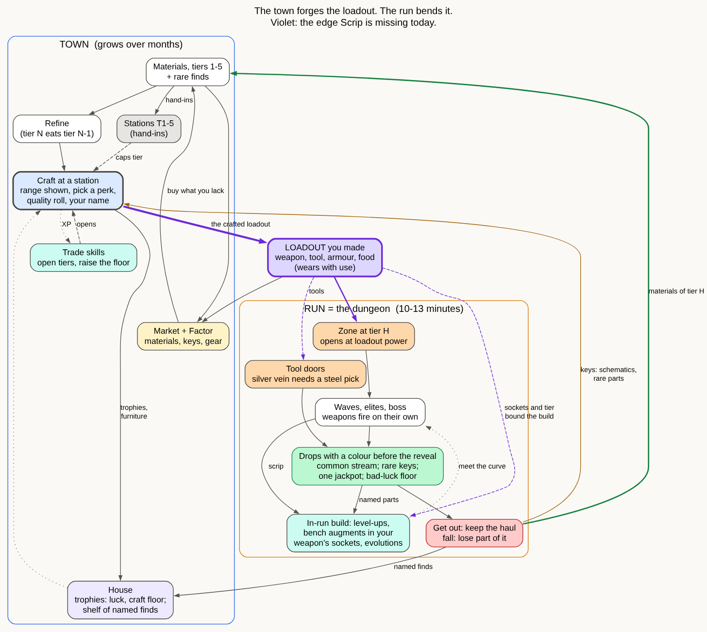

# Round 3: the whole picture

Three studies, in this folder:

- `nw-loot-mechanics.md`: how every drop in New World is made, with numbers read
  from nwdb, the official patch notes and the wiki.
- `nw-system-graph.md`, with `nw-system.dot` and `nw-system.svg`: New World as one
  graph, with 135 nodes and 15 loops, and Scrip mapped against it.
- `nw-loot-experience.md`: how its loot feels over a player's life, and what makes
  loot exciting across games.

The proposed whole-game structure is `skeleton.dot` / `skeleton.svg`. Nothing has
been built for this round.

## What New World is, as a system

- **The drop is the key, the craft is the item.** About 4,400 of nwdb's 8,100
  recipes turn a drop-only key (a schematic, pattern, materia or raid key) into
  gear. Loot feeds crafting; it does not bypass it.
- **What you fight and gather with comes out of the chain.** Every tool is crafted.
  The tutorial has you craft your first weapon. Your pickaxe's luck perk finds the
  rare ore, the ore adds a perk to your sword, and the trophy you built raises
  the sword.
- **One ladder carries the game.** Better gear opens harder content. Harder content
  drops rarer materials and keys, which make better gear. Around it run the
  trade-skill bars, with about 50 in all, so one is always close to a ding.
- **Three things make each drop exciting:**
  1. A roll you can read at a glance from its colour.
  2. Named targets at known places, behind odds you can improve (luck from food,
     trophies and tools), with a floor under bad luck.
  3. A market that turns any lucky drop into coin.
- **Crafting and drops each have their own job.** Drops bring surprise and rare
  parts. Crafting brings control, a floor, your choice of perk and your name. Each
  time one side made the other pointless, players left: crafted gear was scaled
  down in 2021, and crafting could make anything in 2023.

## Where Scrip stands

Scrip has New World's town (stations, market, sinks, discovery) and Brotato's run.
The edge that joins them is missing: **the gear you take into the fight is not made
by you.** The start weapon is free. Every other weapon, and the hatchet, pick and
knife, is bought with run scrip at the bench, and that scrip is gone when the run
ends. Fusion makes only kit items.

So the town's goods never reach the fight's spine, and the fight's rewards never
reach the town's. That is why collecting has had no purpose in every version,
including the three prototypes, which each built one slice next to the gap.

## The proposal: the town forges the loadout, the run bends it

1. **Everything you fight and gather with is made at a station.** This covers
   weapons, tools, armour and food. A craft shows its range, lets you choose a
   perk with a rare part, rolls the quality and puts your name on the result.
   Gear wears with use.
2. **The run stays a run.** It keeps waves, elites, the boss, level-ups and
   weapons that fire on their own. The bench no longer sells weapons. It sells
   augments that fit your weapon's sockets, tier-ups up to one tier past what you
   made, and items. Named parts that drop in the run evolve your weapon at the next
   bench. So you still meet the curve inside the run, but how far the run can go
   is set at home.
3. **Zones by tier.** Your loadout's power opens the next zone, which has new
   creatures, new materials and a new boss. The hazard ladder becomes this.
4. **Tool doors.** A silver vein that needs a steel pick, or an elite you can only
   skin with a better knife. Each door opens a resource, and that resource opens
   the next craft.
5. **Drops with a colour before the reveal.**
   - Common materials stream in with no ceremony.
   - A run brings two or three rare keys (schematics, named parts, rare finds) and
     at most one jackpot.
   - A bad-luck counter guarantees a jackpot within three or four runs.
   - Getting out keeps the haul; a fall loses part of it, but schematics always
     come home.
6. **The town grows over months.** Trade skills open tiers and raise the craft floor.
   Stations cap the craft tier. House trophies add luck and raise the floor. A shelf
   holds your named finds, and the market sells what you don't need.
7. **The AI belongs at the station.** The first time anyone combines a set of
   materials, the model picks effects from the closed list within that tier's
   budget, and the maker names it. That keeps the discovery you liked, now inside
   the chain rather than beside it.

## Your first hour, as you would play it

1. **The forge.** You start with no weapon and a crate of green wood and iron.
   You make a plain sling; the quality roll lands at 92, so it reads
   "Your sling, 92". You make a stone pick.
2. **Run 1, the home wood.** The waves are as they are now, and wood, iron and hide
   tick up on the counters. The bench sells two augments for your sling's two
   sockets, a split shot and faster fire, plus upgrade picks.
3. **The first elite.** It drops a blue glint: a boar tusk, which becomes a Tusk
   sling at the next bench for the rest of the run.
4. **A locked door.** A silver vein in the corner stays shut: "needs a steel pick".
5. **The end of run 1.** You fall in wave 9 and keep 60% of the haul. You also
   found the Steel pick schematic, which you always keep.
6. **Back in town.** You smelt iron into steel, which takes Smithing to level 2.
   You make the steel pick, cook a stew for the next run, and hand timber in to
   the sawmill.
7. **Run 2.** The silver vein opens, and silver drops. The boss gives an orange,
   Old Tusk's heart, which can go on your shelf or into a craft. The first time
   anyone forges silver with reed, the model makes a "whip-sling"; you name it,
   and it enters the codex.
8. **Tier 2.** Your loadout is now strong enough for the fen: new creatures, aged
   wood, silver and reed.

## Kept, changed, added

- **Kept:**
  - the run sim, waves, enemies, weapons and stats;
  - the bench (repurposed);
  - fusion, which becomes discovery at the station;
  - the market and Factor, stations, kit charges and relics, which become the
    jackpot tier.
- **Changed:**
  - no free weapon;
  - the bench sells augments, not weapons;
  - the hazard ladder becomes zones;
  - drops get tiers and colours.
- **Added:**
  - material tiers;
  - refining;
  - weapon and tool recipes with sockets;
  - tool doors;
  - trade skills;
  - house trophies;
  - a named-drop list per elite.
- **Dropped:** the gather lull, standing in rings as the main way to gather, and
  the loot prototype's shopping-list strip.

## Decisions for you

1. Is this the big picture you want the game to be?
2. Should the bench stop selling weapons? It is the largest change to the part you
   liked in Brotato. Augments, sockets and evolutions are meant to replace it.
3. How should it be tested? The proposal is one thin version through every node of
   the graph, with two tiers and a few recipes, rather than another slice. It needs
   the first decision first.
